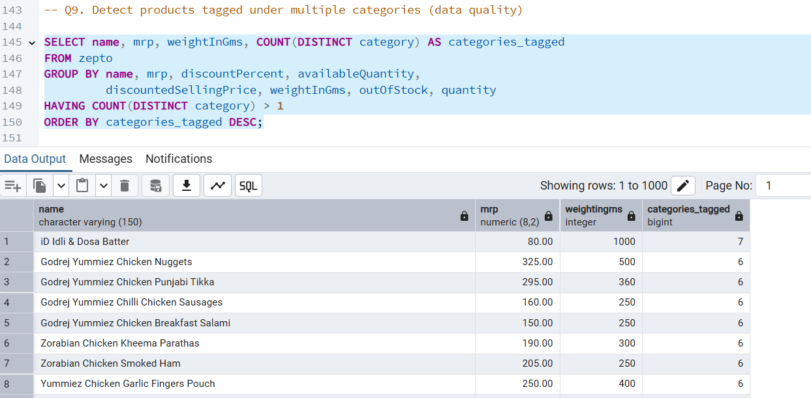
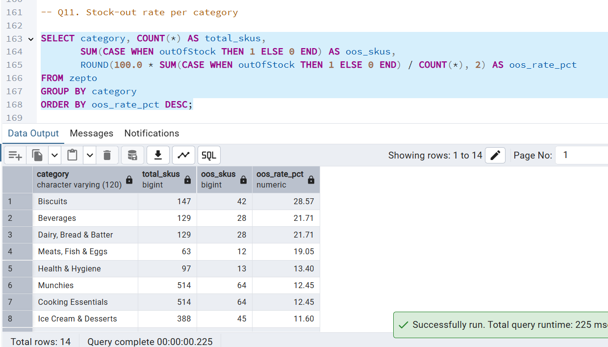
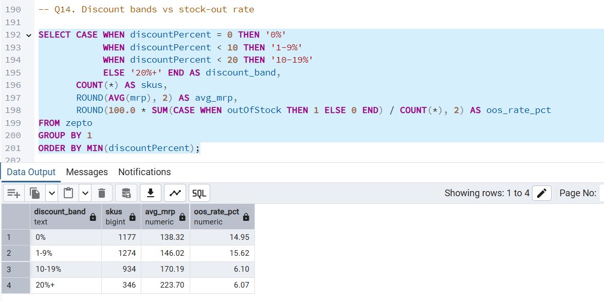

# Zepto Inventory & Pricing Analysis (PostgreSQL)

SQL analysis of a Zepto quick-commerce product catalogue: data cleaning, duplicate detection, discount and pricing analysis, and stock-out insights.

## Business Questions
- Which categories have the highest stock-out rates?
- Do heavily discounted products run out of stock less often?
- Where does price per gram vary most across pack sizes?
- Can the category data be trusted for revenue analysis?

## Dataset
- `data/zepto_v2.csv`: 3,732 raw rows, 9 columns, 14 categories
- Columns: category, name, mrp, discountPercent, availableQuantity, discountedSellingPrice, weightInGms, outOfStock, quantity
- Prices are stored in paise and converted to rupees during cleaning
- Source: <add Kaggle dataset link>

## Tools & SQL Concepts
PostgreSQL, pgAdmin | Aggregations, GROUP BY / HAVING, CASE WHEN, CTEs, window functions (SUM OVER, ROW_NUMBER), DISTINCT ON, views, data cleaning (UPDATE / DELETE)

## Workflow
1. Created the schema and imported the CSV
2. Explored: row count, NULLs, categories, stock status, repeated names
3. Cleaned: removed 1 zero-price row (3,731 rows left), converted paise to rupees, flagged zero-weight products, detected duplicates
4. Analysed: 16 queries in `sql/zepto_analysis.sql`

## Key Findings
- **Data quality problem:** the same product is tagged under several categories (one product appears in 7). Of <TOTAL> rows, only <UNIQUE> are unique products. Cooking Essentials and Munchies have identical row counts (514), stock-outs (64) and revenue, so category-level totals are inflated for these groups.
- **Stock-outs:** Biscuits have the highest stock-out rate at 28.57%. Beverages and Dairy, Bread & Batter follow at 21.71%.
- **Discounts vs stock-outs:** products discounted 10% or more are out of stock about 6% of the time (6.10% and 6.07%), versus about 15% for products discounted 0-9% (14.95% and 15.62%). This is an association, not proof that discounts prevent stock-outs.

## Sample Outputs
**Products tagged under multiple categories**


**Stock-out rate by category**


**Discount band vs stock-out rate**


## Limitations
- Estimated revenue = discounted price x available quantity. It is stock-on-hand value, not actual sales.
- Category tags are unreliable because of the duplication above.
- Single snapshot, so no trend analysis is possible.

## How to Run
1. Create a PostgreSQL database.
2. Run the CREATE TABLE section of `sql/zepto_analysis.sql`.
3. Import `data/zepto_v2.csv` into `zepto` (exclude `sku_id`, header on, UTF-8).
4. Run the rest of the script top to bottom. The paise-to-rupees UPDATE must run only once.

## Repo Structure
```
data/          raw CSV
sql/           full SQL script (16 queries)
screenshots/   query outputs
```

## Author
Ramkumar Sharma | [Portfolio](https://ramkumar-data-analyst-portfolio.vercel.app/) | [LinkedIn](https://linkedin.com/in/ramkumar-sharma-843b752b8)
